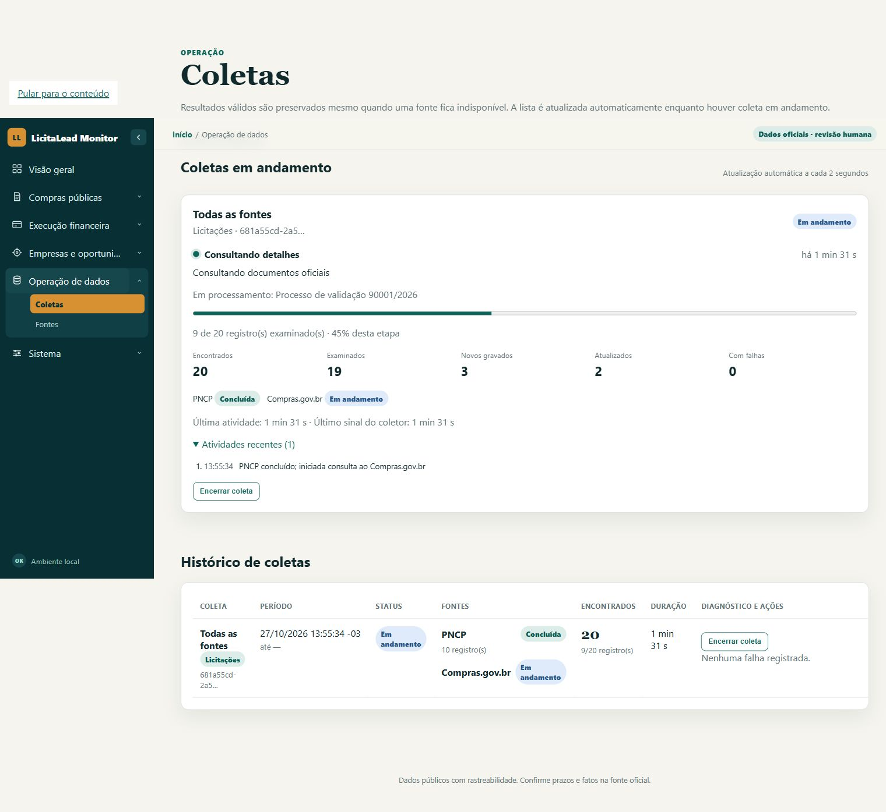

# Acompanhamento de coletas — 2026-10-27

> **Registro histórico:** descreve o estado e os resultados da data indicada. Consulte a [documentação atual](README.md).

`/crawls` apresenta um painel de acompanhamento acima do histórico. Cada coleta
mostra etapa, fonte, processo/documento atual, duração, última atividade,
heartbeat, contadores confirmados e até 20 atividades recentes.

O painel atualiza a cada dois segundos enquanto há trabalho e a cada 15 segundos
quando ocioso, detectando coletas iniciadas por outro processo. Fontes aguardando,
ativas e concluídas têm estados independentes. As três conclusões mais recentes
permanecem em destaque por dois minutos; o histórico é sincronizado nas transições.

Porcentagens se referem à etapa atual e aparecem somente com total conhecido.
Descoberta sem total e gravação municipal atômica usam indicador indeterminado.
Registros encontrados/examinados não significam registros gravados: novos e
atualizados são divulgados após commit. Durante uma transação municipal, a
mensagem informa que o lote aguarda confirmação.

O acompanhamento usa campos opcionais `progress` e `activity` no JSON `cursor`
existente, preservando `sources` e demais campos. Não exige nova migração.
Conectores HTTP e processamento documental possuem callbacks opcionais;
atualizações próximas são consolidadas, inclusive com flush do último evento
em até dois segundos. Escritas continuam protegidas por lease/fencing e os
flushes pendentes são encerrados antes da finalização.

`GET /crawls/progress` retorna o fragmento HTML sem cache. Detalhes abertos e
foco são preservados no polling. Falha de atualização mantém os últimos dados e
mostra aviso; após recuperação o aviso desaparece. Ausência de heartbeat por
mais de 150 segundos produz um alerta sem declarar que o worker parou.

## Validação

- Python 3.12.10; **577 testes offline aprovados**, dois live excluídos.
- Cobertura de **84,58%**, com branches e mínimo obrigatório de 80% preservados.
- Ruff aprovado; formatação aprovada em 237 arquivos; mypy aprovado em 111 arquivos.
- Regressões para descoberta bloqueada com progresso visível, flush consolidado,
  limite de atividades, retries HTTP, totais desconhecidos, metadados legados,
  fonte concluída enquanto outra continua, HTML escapado e worker antigo impedido
  de sobrescrever progresso de recuperação.
- Transação municipal verificada antes do commit e após cancelamento/rollback:
  pagamentos ainda não confirmados não aparecem como gravados.
- Chrome com servidor e SQLite temporários: observados aguardando → executando →
  parcial → concluída, preservação de detalhes/foco e atualização do histórico.
  Falha HTTP 503 de polling e recuperação foram simuladas e verificadas.
- Layout móvel verificado em viewport de 390 px, sem overflow do painel.

A confirmação visual do botão de cancelamento não foi concluída: a automação
do Chrome foi interrompida por não conseguir determinar a URL com confiança
enquanto o diálogo estava aberto. O cancelamento e o rollback passaram nos
testes automatizados. O servidor temporário foi encerrado após a validação.

Nenhuma coleta real, migração ou alteração do banco de uso foi feita. Os dados
da captura abaixo são simulados; a suíte offline exerceu os serviços reais com
fontes substituídas por respostas controladas.

