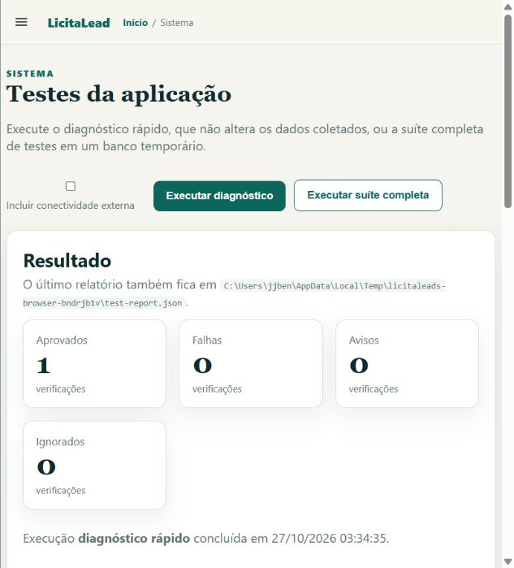

# Correções da auditoria — 2026-10-26

> **Registro histórico:** descreve o estado e os resultados da data indicada. Consulte a [documentação atual](README.md).

Implementação e validação das pendências confirmadas. O banco de uso não foi
migrado, reconciliado nem modificado. Testes, migrações e navegador usaram
armazenamento temporário. As alterações existentes no workspace foram preservadas.

## Comportamento corrigido

| Área | Resultado |
|---|---|
| Respostas oficiais | Envelopes e linhas inválidas geram erro de contrato; não viram `EMPTY`. Páginas válidas anteriores são preservadas com indicação de resultado parcial. |
| Paginação | Compras considera `totalPaginas` e `paginasRestantes`, inclusive na descoberta. Há detecção de repetição, contradições e limites defensivos. Resultados PNCP por item também usam o coletor paginado. |
| Proveniência | Linhas são associadas a `RawSourceRecord.record_key`, não à sua posição na lista. Referência explícita ausente ou fallback ambíguo gera diagnóstico. |
| Completude | `ConnectorResult.is_complete` centraliza a regra. A revisão Alembic `0020_source_completeness` adiciona `collection_complete` e `pagination_metadata` sem alterar o bruto legado; completude antiga permanece desconhecida. |
| Retrações | Documentos inativos e resultados cancelados não retraem fatos em coleções parciais ou truncadas. O cancelamento preserva a identidade do papel do resultado original. |
| Concorrência | Gravações verificam proprietário, geração e validade da lease dentro da transação. Renovação não muda a geração. Contextos de execução são separados entre chamadas concorrentes, inclusive no mesmo objeto de serviço. |
| Cancelamento | Há checkpoints antes das requisições/tentativas e nas gravações municipais. Perda de lease interrompe o worker. Finalizações antigas não sobrescrevem estado terminal, e fechamento com erro não retém a lease. |
| Pagamentos | Importações independentes usam lotes configuráveis de 250. A substituição municipal de agregados continua atômica, inclusive diante de exceção ou cancelamento. |
| Página de testes | Ações deixam de aparecer em duplicidade; polling reativa os botões. Cancelamento anterior ao início ou durante aquisição da lease também produz estado terminal. |
| Subprocessos | Alembic e pytest compartilham execução controlada com timeout, saída limitada e encerramento dos descendentes. O filho ignora o `.env` real e limpa credenciais e instrumentação de cobertura herdada. |
| Reconciliação | Simulação não altera entidades. Aplicação exige backup verificado, com manifesto e relatório de impacto antes dos reparos. Correspondências ambíguas não são reparadas; documentos legados sem completude comprovada são preservados. |
| Diagnósticos | Testam endpoints e estruturas consumidas; HTTP 200 com manutenção em HTML/JSON não conta como fonte saudável. A auditoria OpenAPI distingue rotas encontradas e contratos mínimos efetivamente verificáveis. |

## Validação offline

- Python 3.12.10; banco e arquivos temporários; Alembic aplicado antes da suíte.
- **367 testes aprovados; 2 contratos vivos excluídos; cobertura de 80,82%**, com
  branches e limite de 80% mantidos.
- `ruff check .`, `ruff format --check .` e `mypy app`: aprovados.
- Migração do zero e upgrade de schema legado com payload sentinela preservado.
- Regressões de perda de lease, aquisição concorrente, rollback municipal,
  fontes malformadas, referência por página e reconciliação ambígua.
- Banco e arquivos sentinelas preservados diante de `.env` hostil; processos
  filhos e netos encerrados no cancelamento e no timeout.
- Lifespan verificado inclusive com falha em uma etapa de limpeza.

## Navegador

Instância temporária com execução simulada de oito segundos. Foram observados
os botões desabilitados durante a execução e reativados pelo polling, sem
duplicação. A instância foi encerrada após a verificação.

## Fontes oficiais e limites observados

O [relatório das consultas limitadas](source_validation_2026-10-26.md) registra
resultados por operação, amostras sem dados suficientes e falhas externas.
PNCP e Compras.gov.br devolveram processos e itens reconhecidos. Documentos do
PNCP falharam numa consulta inicial e responderam na repetição; a amostra não
continha item com resultado PNCP publicado para validar essa operação.

São Luís respondeu HTTP 403. As alternativas HTTPS de Imperatriz, Timon e
Caxias tiveram erro de conexão; o catálogo HTTP foi preservado, com opt-in
obrigatório. A Transparência federal não foi consultada por ausência de chave
ou CNPJ configurado. Essas situações não foram convertidas em sucesso ou
`skip` silencioso; o validador externo terminou com código 1.

O backup PostgreSQL exige `pg_dump`; a recusa quando a ferramenta está ausente
foi testada. Não houve conexão a um PostgreSQL de uso nem restauração de um
dump real nesta rodada.

## Aplicação no ambiente de uso

A migração está preparada e testada, mas não foi aplicada ao banco do operador.
O launcher continua responsável por selecionar e migrar seu banco efetivo.
`reconcile-data --apply` não foi executado. Consulte `docs/cli.md` antes de usar
esse comando com dados existentes.
