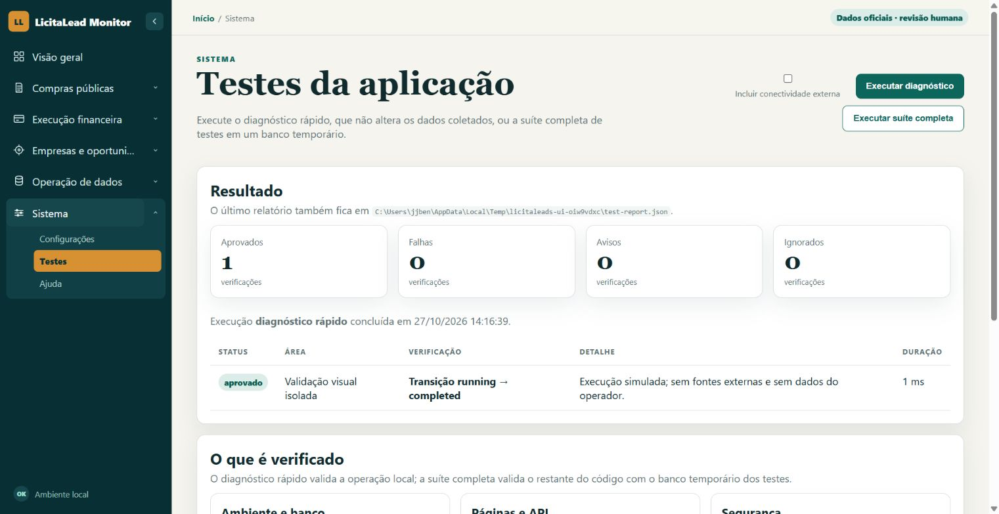

# Validação visual da página de testes — 2026-10-27

> **Registro histórico:** descreve o estado e os resultados da data indicada. Consulte a [documentação atual](../README.md).

Validação realizada no Chrome com servidor temporário em porta efêmera,
banco SQLite migrado e diretórios de armazenamento inteiramente temporários.
Scheduler, LLM, OCR, busca de contatos e contratos live permaneceram desligados.
O diagnóstico foi substituído somente no processo de validação por uma
execução simulada controlada; não foram consultadas fontes externas.

1. O GET inicial mostrou um único grupo de ações.
2. O clique em **Executar diagnóstico** mostrou **Executando**, os dois botões
   de execução desabilitados e a ação **Cancelar execução**.
3. Após liberar a execução simulada, o polling HTMX mostrou o relatório
   concluído, com uma verificação aprovada e nenhuma falha.
4. Os dois botões voltaram a ficar habilitados e a ação de cancelamento
   desapareceu, sem recarregar a página.

A aba de validação foi fechada e o servidor temporário foi encerrado.
O banco e a instância em uso pelo operador não participaram desta verificação.
Esta evidência demonstra a transição da interface; não substitui os testes
automatizados nem confirma disponibilidade de fontes oficiais.

