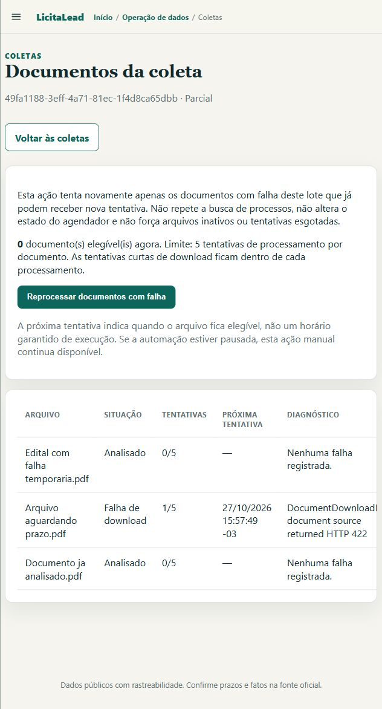

# Reprocessamento seletivo de documentos — 2026-10-27

> **Registro histórico:** descreve o estado e os resultados da data indicada. Consulte a [documentação atual](README.md).

## Uso

1. Abra `/crawls` e escolha **Arquivos, falhas e próximas tentativas**.
2. Confira o arquivo, a falha, o número de tentativas e o prazo de elegibilidade.
3. Use **Reprocessar documentos com falha** quando houver arquivos elegíveis.
4. Acompanhe a nova execução, identificada como **Reprocessamento de documentos**.

O botão também está disponível no histórico e nos cartões com falha documental.
Não refaz consultas de processos, itens ou resultados. Não retoma o scheduler.
Arquivos analisados, pendentes sem falha, inativos, fora do lote, com prazo
futuro ou tentativas esgotadas não entram nessa ação.

## Integridade e retentativas

Cada novo lote processado registra uma lista estável de IDs de documentos no
cursor da execução. A ação consulta a situação atual desses IDs e registra uma
execução filha com vínculo à origem. Coletores antigos sem essa lista usam
somente documentos ligados às suas respostas oficiais; a interface informa a
limitação e não amplia automaticamente a seleção para todas as falhas do banco.

Há exclusão mútua entre processamento documental da API, pipelines, CLI e
scheduler, com heartbeat e fencing. Cliques simultâneos não admitem dois
reprocessamentos. Cancelamento libera a lease e mantém resultados confirmados.
Arquivos desativados durante o download são ignorados e não contam como analisados.

O download recebe no máximo três tentativas apenas quando o PNCP devolve HTTP
422 com a mensagem específica **Erro ao tentar carregar arquivo**. As esperas
curtas são de dois e cinco segundos, com checkpoints de cancelamento/propriedade.
Outros erros 422, respostas não JSON e erros de outros hosts não recebem essa
repetição. O corpo bruto e nomes internos do armazenamento não são publicados.

Quando as três tentativas falham, o documento permanece com falha explícita e
segue o backoff de processamento já existente, sem ser tratado como vazio ou
analisado. As tentativas curtas não zeram nem multiplicam artificialmente o
contador de tentativas de processamento. A elegibilidade também é revalidada
quando o worker começa a executar.

## Validação

Testes e navegador usaram exclusivamente bancos e diretórios temporários,
sem coletas oficiais, reprocessamento de dados de uso ou mudança da pausa real.
Nenhuma migração nova é necessária.

No navegador integrado foi observado um arquivo elegível sendo recuperado,
com os outros dois preservados (um já analisado e outro aguardando prazo),
zero consultas de coleta e scheduler ainda pausado. O novo processamento
apareceu no painel e concluiu; o botão ficou desabilitado quando não restaram
arquivos elegíveis. A aba e o servidor temporários foram encerrados.

Resultados finais em Python 3.12.10:

- Suíte offline completa: **599 testes passaram**, dois contratos vivos
  explicitamente excluídos; duração de 651,88 segundos.
- Cobertura de `app/`, incluindo branches: **84,46%**, acima do mínimo de 80%.
- Alembic aplicado antes da suíte somente ao banco temporário.
- `ruff check .` e `ruff format --check .`: aprovados; 243 arquivos formatados.
- `mypy app`: aprovado, 112 arquivos sem erros de tipagem.
- `git diff --check`: aprovado.

As regressões incluem seleção restrita ao lote, concorrência de admissão,
cancelamento e liberação de lease, prazos e limite de tentativas, falha persistente
do PNCP, erros HTTP que não devem ser repetidos e desativação durante o download.
